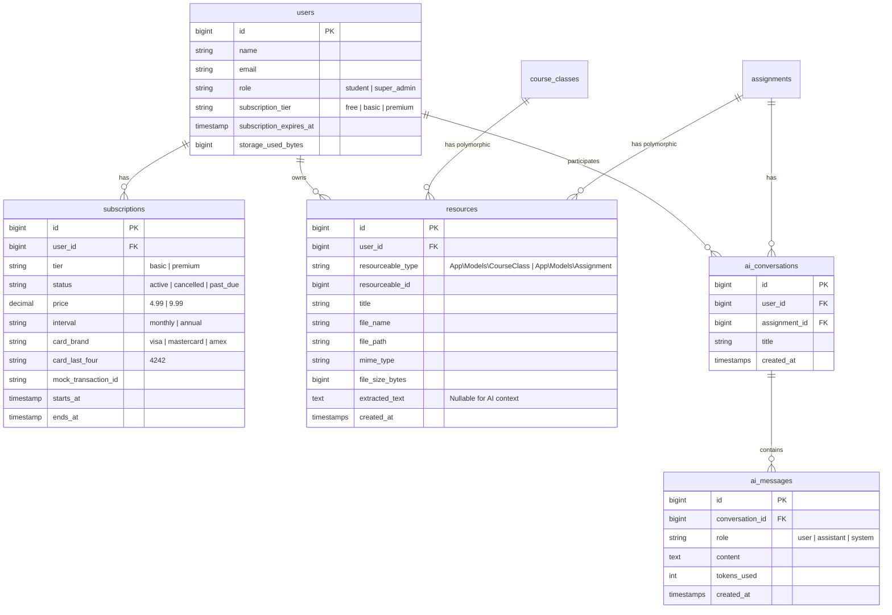

# Due — Subscription, Resources, Gemini AI & Super Admin Architecture Plan

A comprehensive engineering specification and phase-by-phase implementation roadmap for transforming **Due** into a subscription-based academic platform with a **Super Admin Dashboard**, **Class & Assignment Resources Storage/Viewer**, **Gemini-Powered AI Study Assistant**, and **Zero-DB-Query Token-Based Subscription Verification**.

---

## 🏛️ Executive Summary & Scope

This upgrade introduces four flagship capabilities to the Due ecosystem:
1. **Tiered Subscription System with Mock Checkout:**
   - 3 distinct tiers: **Free** (Core), **Scholar** (Basic / Resources), and **Genius** (Premium / Gemini AI).
   - Mocked checkout with realistic credit card form, validation, card brand detection, and instant provisioning.
   - **Zero-DB-Query Verification:** Token-based authorization so neither the web session nor the mobile API queries MySQL for subscription status on every request.
2. **Unified Classroom & Assignment Resources:**
   - Students can upload study materials, lecture slides, diagrams, PDFs, and images per assignment and per class.
   - Secure in-browser preview (PDF reader, image lightbox, text viewer) and download streaming.
3. **Gemini-Powered AI Study Assistant:**
   - Context-aware academic copilot attached to each assignment.
   - Automatically builds prompts injecting assignment details, student notes, and uploaded resource contents.
   - Socratic study partner for explanations, summaries, and coursework planning.
4. **Super Admin Oversight & Resource Dashboard (Web-Only & Stealth Access):**
   - Strictly **Web-Only**: The Flutter mobile app has zero admin capabilities or admin views.
   - **Stealth Entry Point:** Absolutely **NO** button, menu item, or link exists anywhere in the user interface (navigation bar, sidebar, dropdown, or footer).
   - **Manual Browser Navigation & Auth Gate:** The super admin manually navigates via the browser address bar to `/admin`. Unauthenticated visits route to a dedicated Admin Auth page (`/admin/login`), while normal student accounts receive a silent 404 Not Found.
   - Real-time disk utilization metrics, Gemini API token telemetry, user directory, and mock subscription revenue analytics.

---

## 0. Non-Negotiable Directives & Standards

1. **Git Commit Rule:**
   - **NEVER run `git commit` or create git commits automatically.** All git commits must be explicitly left to the user.
2. **Strict Zero Corner Radius:**
   - Maintain Due's sharp, technical, and architectural visual identity.
   - Every UI element on Web and Mobile (buttons, inputs, cards, dialogs, badges, lightboxes, drawers) must use **`rounded-none`** (`BorderRadius.zero`).
3. **Dark Theme Default & Palette:**
   - Primary dark theme by default: Background `#09090B`, Surface `#18181B`, High-contrast Border `#27272A`, Muted Text `#A1A1AA`, Coral Accent `#FF2D20`.
   - Typography: Clean sans-serif headers and body, monospace font for dates, badge indicators, tokens, and numerical metrics.
4. **Stealth Admin Access & Web-Only Scope:**
   - **Zero UI Links:** Under no circumstances should there be a link, button, or badge leading to `/admin` in the student-facing layout or user dropdown.
   - **Manual Address Bar Entry:** Access is initiated solely by manually typing `/admin` in the browser URL bar.
   - **No Mobile Admin:** Mobile app (`mobile/`) remains 100% focused on student workflows (coursework, assignments, resources, and AI).
5. **Maintain Full Student Feature Parity:**
   - Student features (subscriptions, mock checkout, resources upload/preview, Gemini study assistant) must be built cleanly on **Laravel 13 + React/Inertia** and exposed via `/api/v1/` for the **Flutter** mobile client.

---

## 1. System Architecture & Subscription Model

### 1.1 Subscription Tiers & Feature Matrix

| Feature / Limit | Free (`free`) | Scholar / Basic (`basic`) | Genius / Premium (`premium`) |
| :--- | :---: | :---: | :---: |
| **Course & Class Management** | Unlimited | Unlimited | Unlimited |
| **Assignments & Deadlines** | Unlimited | Unlimited | Unlimited |
| **Assignment Notes** | Unlimited | Unlimited | Unlimited |
| **Deadline Urgency Engine** | Yes | Yes | Yes |
| **Classroom & Assignment Resources** | ❌ None | ✅ Unlimited Files | ✅ Unlimited Files |
| **Max File Upload Size** | 0 MB | 25 MB per file | 100 MB per file |
| **Total Storage Quota** | 0 MB | 500 MB | 5 GB |
| **Gemini AI Study Assistant** | ❌ None | ❌ None | ✅ Unlimited Chat |
| **Context Extraction from Files** | ❌ None | ❌ None | ✅ PDFs, Images & Notes |
| **Pricing (Simulated)** | $0 / mo | $4.99 / mo | $9.99 / mo |

---

### 1.2 Token-Based Subscription Verification (Zero-DB-Query Architecture)

**Problem:** In traditional architectures, checking if a user has access to a feature executes `SELECT * FROM subscriptions WHERE user_id = ?` or reads `users.subscription_tier` on every single HTTP request. This adds unnecessary database latency.

**Solution:** Issue a **cryptographically signed, self-contained Subscription Passport Token** (or encode capabilities into auth tokens/sessions):

```
┌────────────────────────────────────────────────────────────────────────┐
│               Subscription Passport Token Payload (Signed)             │
│                                                                        │
│  {                                                                     │
│    "uid": 42,                                                          │
│    "tier": "premium",                                                  │
│    "features": ["resources:upload", "resources:view", "ai:chat"],      │
│    "quota_bytes": 5368709120,                                          │
│    "exp": 1799999999,                                                  │
│    "sig": "hmac_sha256_hash_with_app_key"                             │
│  }                                                                     │
└──────────────────────────────────┬─────────────────────────────────────┘
                                   │
         ┌─────────────────────────┴─────────────────────────┐
         ▼                                                   ▼
┌─────────────────────────────────┐   ┌─────────────────────────────────┐
│     Web App (Inertia Session)   │   │     Mobile App (Sanctum API)    │
│                                 │   │                                 │
│ - Claims stored in Session      │   │ - Capabilities embedded in      │
│ - Middleware verifies session   │   │   Sanctum token abilities:      │
│   claims in-memory              │   │   tokenCan('feature:resources') │
│ - ZERO database queries         │   │   tokenCan('feature:ai')        │
│                                 │   │ - ZERO additional DB queries    │
└─────────────────────────────────┘   └─────────────────────────────────┘
```

#### How it works in practice:
1. **For Mobile REST API (Laravel Sanctum):**
   - Sanctum already fetches the token row once during authentication.
   - When issuing or refreshing the token upon checkout/downgrade, we assign **Sanctum Abilities**:
     - `free`: `['feature:core']`
     - `basic`: `['feature:core', 'feature:resources']`
     - `premium`: `['feature:core', 'feature:resources', 'feature:ai']`
   - In route middleware: `Route::middleware('ability:feature:resources')` or `$request->user()->tokenCan('feature:resources')`.
   - **DB queries added:** `0` (Sanctum token abilities are already loaded in memory during the initial token lookup).
2. **For Web (Inertia / Session):**
   - When the user logs in or subscribes, Laravel stores a cryptographically signed payload (`SubscriptionPassport`) in `session('subscription_passport')`.
   - The custom middleware `EnsureSubscriptionFeature('resources')` simply verifies the in-session passport signature against `APP_KEY`.
   - **DB queries added:** `0`.
3. **Invalidation & Refresh:**
   - Whenever a user upgrades, cancels, or the Super Admin alters their subscription, an event (`SubscriptionUpdated`) invalidates the session claim and regenerates the token abilities instantly.

---

## 2. Feature Specifications

### 2.1 Mock Checkout & Billing Flow

* **Plans Page (`/pricing` & `/settings/subscription`):**
  * Sharp comparison table highlighting Free vs. Scholar vs. Genius.
  * Monthly / Annual toggle ($4.99/mo vs $49/yr, $9.99/mo vs $99/yr).
  * Feature callouts with zero-radius badges.
* **Checkout Page (`/checkout?plan=scholar`):**
  * Order summary: Subtotal, Simulated Taxes ($0.00), Total Due Today.
  * Interactive Mock Payment Form:
    * Cardholder Name
    * Card Number (with automatic Visa/Mastercard/Amex icon detection)
    * Expiration Date (`MM/YY` format mask)
    * CVC (`3-4` digits)
    * Billing ZIP/Postal Code
  * Visual Credit Card Preview Widget:
    * Updates live as the user types (masked number, cardholder name, expiry).
  * Simulated Processing Stepper:
    * Click "Complete Subscription" ➔ Button shows:
      1. *Authorizing Card...* (400ms)
      2. *Creating Secure Token...* (400ms)
      3. *Activating Plan...* (300ms)
    * Redirects to `/dashboard` with celebration toast: *"Welcome to Scholar Tier! Resources unlocked."*
* **Subscription Management (`/settings/subscription`):**
  * Displays current tier, mock card on file (`•••• •••• •••• 4242`), and next renewal date.
  * One-click "Upgrade to Genius" or "Downgrade to Free" with confirmation dialog.

---

### 2.2 Class & Assignment Resources (Upload & In-Browser Viewer)

* **Polymorphic Architecture:**
  * Resources can belong to a `CourseClass` (e.g. syllabus, textbook PDF, lecture slides) OR an `Assignment` (e.g. assignment brief, rubric, starter diagram, reference paper).
* **Upload Experience:**
  * Zero-radius drag-and-drop file upload zone.
  * Supports: `.pdf`, `.png`, `.jpg`, `.jpeg`, `.webp`, `.doc`, `.docx`, `.txt`, `.md`, `.zip`.
  * Upload validation: verifies file mime-type and enforces per-tier file size limits and total student storage quotas.
* **Storage & Security:**
  * Files are stored privately in `storage/app/resources/{user_id}/{resource_id}.ext`.
  * Never exposed directly via static public URLs.
  * Access is strictly controlled through policy: students can only access files belonging to their own classes and assignments.
* **In-Browser Viewer & Lightbox:**
  * **Images (`png`, `jpg`, `webp`):** Full-screen architectural lightbox modal with zoom and original filename details.
  * **PDFs (`pdf`):** Integrated PDF viewer modal stream (`Content-Disposition: inline`) allowing reading slides and papers without downloading.
  * **Text/Markdown (`txt`, `md`):** Monospace text viewer with line numbers and quick-copy.
  * **Other files:** Instant secure download stream (`Content-Disposition: attachment`).

---

### 2.3 Gemini AI Study Assistant

* **Purpose:** An intelligent copilot that acts as a 24/7 personal tutor for each assignment.
* **Context Assembly Engine (`AssignmentAiContextService`):**
  When a student asks a question about an assignment, the system automatically builds a high-fidelity context prompt:
  ```
  [SYSTEM PROMPT]
  You are Due Copilot, an elite academic tutor. Your mission is to help the student 
  understand, structure, and complete their assignment through clear Socratic guidance, 
  concept explanations, and actionable outlines. Do NOT write full solutions that promote 
  academic dishonesty; instead, guide, review, and explain.

  [ASSIGNMENT DETAILS]
  Title: Operating Systems Lab 3: Process Scheduling
  Class: Computer Science 301
  Deadline: 2026-10-25 23:59:00 (Urgency: DUE SOON)
  Description: Implement Round Robin and Priority Scheduling in C.

  [STUDENT'S NOTES]
  - Note 1: Professor mentioned quantum should default to 4ms.
  - Note 2: Pay attention to edge case where burst time is 0.

  [ATTACHED RESOURCES]
  - Resource: lab3_spec.pdf (Extracted Text: "Section 2.1 specifies the PCB struct...")
  - Resource: starter_code.c (Text preview...)

  [CONVERSATION HISTORY]
  Student: How should I structure the PCB queue?
  ```
* **Gemini Model:**
  * Powered by **`gemini-1.5-flash`** (or `gemini-2.0-flash`) via Google Generative AI REST API or official SDK.
  * Ultra-fast latency (~500ms), huge context window (1M tokens), native multimodal support for image and document comprehension.
* **Chat Interface (`AssignmentDetail` View):**
  * Sharp split-view or expandable side-drawer on the assignment detail page.
  * Interactive suggested prompts:
    * *"Summarize assignment requirements"*
    * *"Break this down into step-by-step milestones"*
    * *"Explain the core concepts from my attached resources"*
    * *"Review my notes for any missing edge cases"*
  * Message history with Markdown formatting, syntax-highlighted code blocks, and copy buttons.
  * Token usage and query counters to monitor usage.

---

### 2.4 Super Admin Oversight & Resource Dashboard (Web-Only & Stealth Portal)

* **Strictly Web-Only:** No mobile client integration, screens, or models are created for admin functions.
* **Stealth Access Architecture:**
  * **Zero UI Footprint:** There are **NO** navigation links, sidebar buttons, footer links, or user avatar dropdown items anywhere in the student web application.
  * **Manual Address Bar Navigation:** The Super Admin enters the portal exclusively by manually typing the URL (e.g. `/admin`) into the browser's address bar.
  * **Dedicated Admin Auth Gate (`/admin/login`):**
    * If a guest visits `/admin`, they are redirected to a dedicated, high-security Admin Auth screen (`resources/js/pages/admin/login.tsx`) with rate limiting and zero-radius aesthetics.
    * If an authenticated regular student attempts to access `/admin` or `/admin/login`, the system returns a stealth **404 Not Found** (preventing students from discovering or probing the admin panel).
    * Upon valid super admin authentication, the user is redirected to `/admin/dashboard`.

#### Dashboard Capabilities:
1. **System Resource Telemetry:**
   * **Disk Usage Tracker:** Total storage consumed across all user uploads (e.g. `1.84 GB / 50.00 GB`), visual monospace storage meter.
   * **File Breakdown:** Count and byte breakdown by category (PDFs, Images, Code/Documents).
   * **Gemini API Stats:** Total AI queries executed, estimated token consumption, and response error rates.
   * **Database Health:** Total users, total classes, total assignments, and active database sessions.
2. **User Management & Subscription Overrides:**
   * Searchable, filterable table of all registered users.
   * Columns: Name, Email, Role, Subscription Tier, Storage Used, Joined Date.
   * **Admin Actions:**
     * Manually upgrade/downgrade subscription tier (instantly regenerates token passport).
     * Toggle Super Admin privileges.
     * View user storage details and list of uploaded resources.
3. **Subscription & Revenue Analytics:**
   * Simulated MRR (Monthly Recurring Revenue) & ARR calculations based on active mock tiers.
   * Tier breakdown distribution chart: Free vs. Scholar vs. Genius.
   * Mock Transaction Log: History of all simulated payments with timestamp, card brand, masked last 4 digits, and tier provisioned.

---

## 3. Database Schema Changes & Migrations



---

## 4. REST API Contract (`/api/v1/`)

All new capabilities will be fully accessible to both the React web application and the Flutter mobile client.

### 4.1 Subscription & Billing Endpoints
* `GET /api/v1/subscription` — Current subscription tier, passport token claims, and storage quotas.
* `POST /api/v1/subscription/checkout` — Submit mock payment details (`card_number`, `exp_month`, `exp_year`, `cvc`, `tier`, `interval`). Upgrades user and returns new token abilities.
* `POST /api/v1/subscription/cancel` — Downgrades user to Free tier at period end.

### 4.2 Resource Management Endpoints
* `GET /api/v1/classes/{classId}/resources` — List all resources attached to a class.
* `POST /api/v1/classes/{classId}/resources` — Upload resource to a class (`multipart/form-data`).
* `GET /api/v1/assignments/{assignmentId}/resources` — List all resources attached to an assignment.
* `POST /api/v1/assignments/{assignmentId}/resources` — Upload resource to an assignment (`multipart/form-data`).
* `GET /api/v1/resources/{resourceId}/view` — Stream file inline for browser/app preview.
* `GET /api/v1/resources/{resourceId}/download` — Stream file attachment for download.
* `DELETE /api/v1/resources/{resourceId}` — Delete resource and reclaim user storage quota.

### 4.3 Gemini AI Study Assistant Endpoints
* `GET /api/v1/assignments/{assignmentId}/ai/messages` — Fetch chat history for an assignment.
* `POST /api/v1/assignments/{assignmentId}/ai/chat` — Send a query to the Gemini assistant.
  * **Payload:** `{ "message": "Can you explain the main requirements?" }`
  * **Response:** `{ "reply": "...", "tokens_used": 142, "context_sources": ["notes", "lab3_spec.pdf"] }`
* `DELETE /api/v1/assignments/{assignmentId}/ai/history` — Clear conversation history.

### 4.4 Super Admin Endpoints (Web-Only / Internal)
*Note: These endpoints are strictly web-only Inertia controller actions protected by stealth admin middleware. They are NOT exposed to or consumed by the Flutter mobile client.*
* `GET /admin` ➔ Redirects to `/admin/dashboard` or `/admin/login`.
* `GET /admin/login` — Dedicated Admin Auth screen (returns 404 if logged in as regular student).
* `POST /admin/login` — Super Admin authentication endpoint with strict throttling.
* `GET /admin/dashboard` — System resource usage, storage, and Gemini API metrics.
* `GET /admin/users` — Paginated user directory with subscription statuses and storage usage.
* `PATCH /admin/users/{userId}/subscription` — Override user subscription tier.
* `GET /admin/subscriptions` — Mock transaction and revenue audit log.

---

## 5. Phase-by-Phase Implementation Roadmap

### **Phase S1: Database Foundations & Models**
*Goal: Scaffold all database tables, models, relationships, and user roles.*

1. Create migration `add_role_and_subscription_to_users_table`:
   - Add `role` (`student`, `super_admin`), `subscription_tier` (`free`, `basic`, `premium`), and `storage_used_bytes`.
2. Create migration `create_subscriptions_table` for mock billing logs.
3. Create migration `create_resources_table` (polymorphic relationship to `CourseClass` and `Assignment`).
4. Create migration `create_ai_conversations_and_messages_tables`.
5. Update [User.php](file:///home/zeamanuel/projects/zainx/due/app/Models/User.php) with new attributes, scopes, and helper methods:
   - `isSuperAdmin()`, `hasFeature('resources')`, `hasFeature('ai')`.
6. Implement Eloquent models:
   - `Subscription.php`
   - `Resource.php` (with polymorphic `resourceable()`)
   - `AiConversation.php` and `AiMessage.php`.
7. Configure seeder with a default `super_admin` user for testing.

---

### **Phase S2: Token-Based Subscription Verification & Mock Billing Engine**
*Goal: Implement zero-DB-query subscription middleware and full mock checkout flow.*

1. **Token Passport & Sanctum Abilities:**
   - Create `App\Services\SubscriptionService`:
     - Method `generatePassport(User $user): array`
     - Method `assignSanctumAbilities(User $user, string $tier): array`
     - Method `processMockCheckout(User $user, array $cardData, string $tier, string $interval): Subscription`
   - Create middleware `EnsureSubscriptionFeature`:
     - Checks session passport claims on Web (`$request->session()->get('subscription_passport')`).
     - Checks Sanctum abilities on API (`$request->user()->tokenCan("feature:{$feature}")`).
     - Rejects unauthorized requests with 403 Forbidden and JSON payload `{ "error": "Subscription upgrade required", "required_tier": "basic" }`.
2. **Mock Payment UI (Web):**
   - Build `/pricing` page with sharp, zero-radius tier comparison cards.
   - Build `/checkout` page with interactive credit card form and live card visualizer.
   - Build `/settings/subscription` for current plan management, upgrade, and cancellation.
3. **Controller & API Endpoints:**
   - Implement `SubscriptionController.php` (Inertia Web) and `SubscriptionApiController.php` (REST API).
4. **Feature Tests:**
   - Test mock card checkout, token ability generation, and feature-gate middleware.

---

### **Phase S3: Classroom & Assignment Resources (Upload & Viewers)**
*Goal: Enable students to upload, manage, preview, and download study resources.*

1. **Storage Setup & Services:**
   - Configure private storage disk in `config/filesystems.php`.
   - Build `App\Services\ResourceStorageService`:
     - Secure file storage with SHA-256 hashed filenames.
     - Storage quota validation (checks tier quota before upload).
     - Text extraction helper (extracts plain text from `.txt`, `.md`, and `.pdf` files for Gemini context).
2. **Controllers & Policies:**
   - Build `ResourceController.php` (Web) and `ResourceApiController.php` (Mobile API).
   - Implement `ResourcePolicy.php` ensuring strict ownership authorization.
   - Add streaming preview endpoint (`/resources/{id}/view`) with proper mime-type headers (`application/pdf`, `image/*`).
3. **Frontend UI Components (React + Tailwind):**
   - Build `<ResourceUploadZone />`: zero-radius drag-and-drop file uploader with upload progress.
   - Build `<ResourceList />`: sharp architectural file cards displaying file format icon, file size, and upload date.
   - Build `<ResourceViewerModal />`:
     - PDF viewer embed.
     * Image lightbox modal.
     * Monospace text reader.
   - Embed resource manager inside `resources/js/pages/classes/show.tsx` and `resources/js/pages/assignments/show.tsx`.

---

### **Phase S4: Gemini AI Study Assistant**
*Goal: Integrate Google Gemini API as an intelligent, context-aware assignment tutor.*

1. **Gemini Integration Service:**
   - Add `GEMINI_API_KEY` and `GEMINI_MODEL=gemini-1.5-flash` to `.env`.
   - Build `App\Services\GeminiApiService`:
     - Direct HTTP integration with Google Generative AI endpoints.
     - Error handling, timeouts, and token count calculation.
2. **Context Engine (`AssignmentAiContextBuilder`):**
   - Automatically collates assignment title, description, deadline urgency, attached notes, and extracted text from attached resources.
   - Injects rigorous Socratic academic guidelines into system prompt.
3. **Controllers & Endpoints:**
   - Build `AssignmentAiController.php` (Web) and `AssignmentAiApiController.php` (Mobile API).
   - Protected by `EnsureSubscriptionFeature('ai')`.
4. **Chat Interface UI (React + Tailwind):**
   - Build `<AssignmentAiChatDrawer />` inside the assignment detail view.
   - Features:
     - Suggested prompt quick-chips.
     - Markdown response rendering with syntax-highlighted code blocks.
     - Auto-scrolling conversation history.
     - Clear context pill showing which notes & files are currently active in Gemini's memory.

---

### **Phase S5: Super Admin Oversight & Resource Dashboard (Web-Only & Stealth)**
*Goal: Build the administrative command center with stealth browser-only entry and dedicated admin auth gate.*

1. **Admin Middleware & Stealth Routing:**
   - Create `EnsureSuperAdmin` middleware:
     - If user is guest: redirect to `/admin/login`.
     - If user is authenticated as regular `student`: abort with `404 Not Found` (stealth mode).
     - If user has `role: 'super_admin'`: allow request through.
   - Register route group `/admin` strictly in `routes/web.php` (no mobile API exposure).
   - **Verification:** Ensure zero buttons, links, or navigation items to `/admin` exist in [app-layout.tsx](file:///home/zeamanuel/projects/zainx/due/resources/js/layouts/app-layout.tsx), navigation menus, or user dropdowns.
2. **Dedicated Admin Auth Gate:**
   - Build `resources/js/pages/admin/login.tsx`: sharp, minimal, technical login screen styled with zero-radius architecture.
   - Implement `AdminAuthController.php` handling `/admin/login` GET & POST with rate limiting.
3. **Metrics & Telemetry Service (`AdminStatsService`):**
   - Calculate total disk storage used by all uploads and remaining capacity.
   - Calculate total Gemini API calls, token usage, and errors.
   - Calculate simulated MRR/ARR and tier distribution counts.
4. **Admin Dashboard Views (React + Inertia):**
   - Build `resources/js/pages/admin/dashboard.tsx`:
     - System resource storage meter.
     - User growth and subscription tier breakdown.
     - Gemini AI activity telemetry.
   - Build `resources/js/pages/admin/users.tsx`:
     - Searchable, filterable user directory.
     - One-click tier override modal (instantly upgrade or downgrade any user).
   - Build `resources/js/pages/admin/subscriptions.tsx`:
     - Simulated revenue overview and mock transaction audit log.

---

### **Phase S6: Flutter Mobile Parity (Student-Only)**
*Goal: Wire up the new student-facing endpoints to the mobile client in `mobile/`.*

1. **Scope Clarification:** The mobile client is **100% student-focused**. No admin screens, admin models, or admin routes are included in Flutter.
2. Update `ApiClient` and `TokenStorage` with subscription ability headers.
3. Build `SubscriptionProvider` with tier status check and mock upgrade modal.
4. Build `ResourceProvider` with file picker integration (`file_picker`), download manager, and in-app viewers.
5. Build `AiChatProvider` and `AssignmentAiChatSheet` for the mobile assignment detail screen.
6. Verify zero-radius design rules on all new mobile widgets.

---

### **Phase S7: Quality Assurance, Security & Performance**
*Goal: Verify test suites, static analysis, and security controls.*

1. Run full Pest test suite (`php artisan test`) covering:
   - Mock checkout and subscription upgrades.
   - Token-based feature gates (verifying zero database queries on feature checks).
   - Resource upload quotas and file security policies.
   - Gemini context builder and mock AI responses.
   - Super Admin authorization safeguards.
2. Run Laravel Pint (`composer lint`) and PHPStan (`composer types:check`).
3. Run `flutter analyze` on the mobile codebase.

---

## 6. Success Criteria & Verification Matrix

| Area | Verification Test | Expected Result |
| :--- | :--- | :--- |
| **Token Verification** | Check feature gate on 100 consecutive requests | **0** database queries to `subscriptions` table. |
| **Mock Billing** | Complete checkout with test card | Instant upgrade, simulated transaction logged, celebration toast shown. |
| **Resources** | Free tier tries to upload a PDF | Blocked with 403 Forbidden prompt to upgrade. |
| **Resource Viewer** | Scholar tier uploads and clicks PDF/Image | Opens in-browser viewer without downloading to disk. |
| **Gemini AI** | Ask question referencing uploaded slide PDF | Gemini answers accurately citing details from the attached slide. |
| **Stealth Admin Access** | Search student UI for any link to `/admin` | **0 links/buttons** found anywhere in DOM or source code. |
| **Admin Route Security** | Regular student manually types `/admin` in address bar | Returns generic **404 Not Found** (no disclosure of admin panel). |
| **Admin Auth Gate** | Unauthenticated user types `/admin` in address bar | Redirects to dedicated `/admin/login` page; Super Admin logs in. |
| **Mobile Scope** | Audit Flutter app codebase | **100% student-focused**; zero admin routes or screens. |
| **Visual Identity** | Inspect all new modals, buttons, and lightboxes | Strict 0 corner radius (`rounded-none`), dark theme default. |
